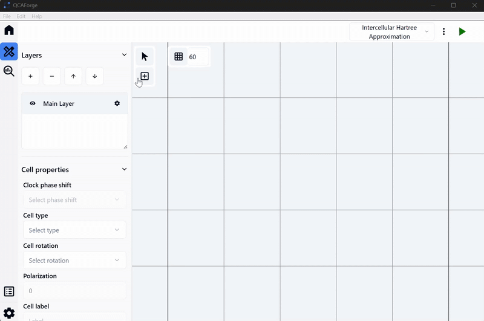
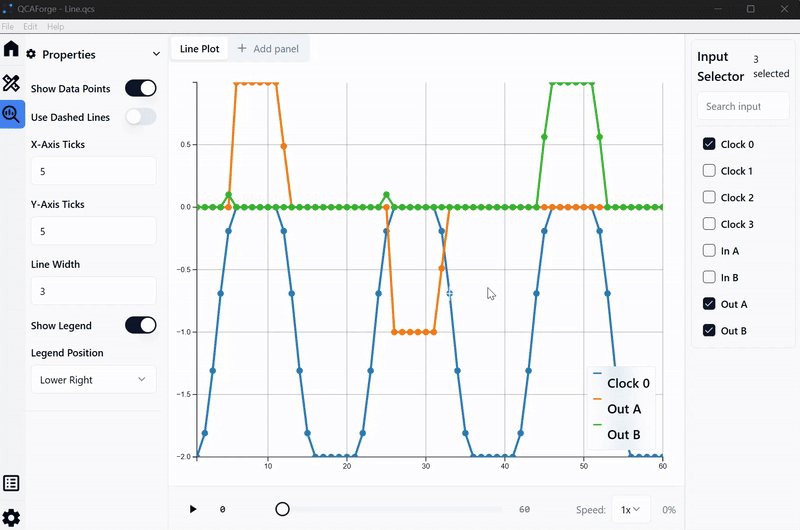

# QCAForge 
[](./LICENSE)
[](https://github.com/mihajanez/QCAForge/actions/workflows/ci.yaml)

**QCAForge** is a desktop application for designing, simulating and analysing binary and ternary quantum-dot cellular automata (QCA). It is built with Tauri, Svelte and Rust and uses the simulation core QCACore of [QCASim](https://github.com/mihajanez/QCASim), so designs and results are interchangeable with the `qca-sim` command-line tool and its Python scripts.

## Features

### Design
Create QCA structures in an interactive visual designer:



- Cell architectures with any number of quantum dots per cell (binary four-dot and ternary eight-dot cells), several layers per design
- Standard cells in four clock zones, input, output and fixed-polarization cells, cell labels
- Designs saved in the open, documented QCD format; figure export of layouts as JPEG, SVG or PDF

### Simulation
- Built-in simulation models: the bistable approximation and the quantum-mechanical ICHA model (intercellular Hartree approximation); settings dialogs are generated from the options of each model, e.g. the cell update order of the ICHA model
- All input combinations or a custom input sequence (editable table, CSV import and export) for sequential circuits
- Simulation in the background with progress reporting; results saved as self-contained QCS files

### Analysis
Visualize and analyze simulation results:



- Signal plot of clock signals and cell polarizations with zooming
- Truth tables with per-cell clock delays
- Structure view of the dot occupancies of all cells, with a timeline that can be scrubbed or played back

### Robustness analysis and HPC
- Export of every numeric geometry, model and clock parameter of a design under a stable identifier
- Sweeps of one or two of these parameters (cell size, dot radius, cell displacement, permittivity, update order, ...), with every variant simulated and scored against the expected logic behaviour (wire, inverter, majority gate, memorizing cell, flip-flops or the truth table of the nominal design)
- Correctness heat maps and contour plots, per-variant truth tables, merged aggregate maps, CSV and figure export
- **Export for cluster**: writes a Slurm job-array job for the [FRIDA](https://docs.rdc.si/) cluster (or any Slurm cluster), run by `qca-sim robustness` with the same engine as the application; see the [HPC guide](https://github.com/mihajanez/QCASim/blob/master/hpc/frida/README.md). Partial results of a running or finished job open together and are merged.
- [`robustness-studies/`](robustness-studies/README.md) contains designs, sweep configurations and results of robustness studies of ternary QCA structures, including campaign tables for HPC clusters.

Example designs (wire, clocked wire, inverter, majority gates, memorizing cell) are in [`examples/`](examples/).

## Download

Installers for Windows (`.exe`) and Linux (`.deb`, `.rpm`, `.AppImage`) are attached to every [release](https://github.com/mihajanez/QCAForge/releases). They are built automatically by the *Deploy QCAForge App* workflow (`.github/workflows/tauri-deploy.yaml`) whenever a version tag `v*` is pushed; the *Build and Test QCAForge App* workflow (`.github/workflows/ci.yaml`) builds the application and runs the frontend and Rust unit tests on every push to `main` and on every pull request. On other platforms, build the application from source as described below.

Releases up to v0.4.0 (2025) are also available from the original repository, [mihoci10/QCAForge](https://github.com/mihoci10/QCAForge/releases).

## Installation & Development

### Prerequisites
- **Node.js** (v18 or higher)
- **Rust** (latest stable)
- **Git**

### Setup Development Environment

1. **Clone the repository:**
   ```bash
   git clone https://github.com/mihajanez/QCAForge.git
   cd QCAForge
   ```

2. **Install dependencies:**
   ```bash
   npm install
   ```

3. **Start development server:**
   ```bash
   npm run tauri dev
   ```
   This will launch the application in development mode with hot-reload enabled.

### Building for Production

```bash
# Build the web frontend
npm run build

# Build the complete desktop application
npm run tauri build
```

## Contributing

Contributions are welcome! Please feel free to submit issues, feature requests, or pull requests.

### Development Guidelines
- Follow TypeScript/JavaScript best practices
- Use Rust formatting standards (`cargo fmt`)
- Write tests for new functionality
- Update documentation as needed

## Acknowledgements

- Special thanks to [@adolenc](https://github.com/adolenc)  for his invaluable testing support and tips on improving the user experience.

## License

This project is licensed under the MIT License. See the LICENSE file for details.

## Contact

For questions, suggestions, or support, please open an issue on GitHub or contact the maintainers.
